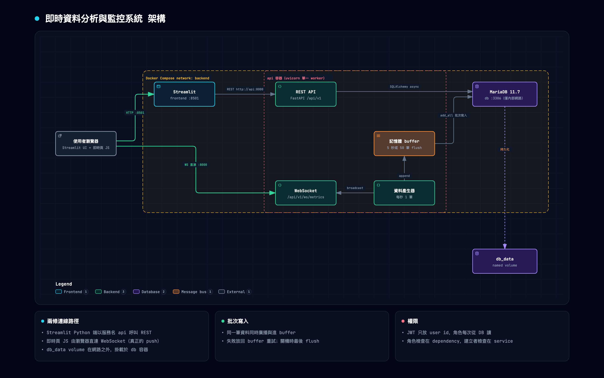
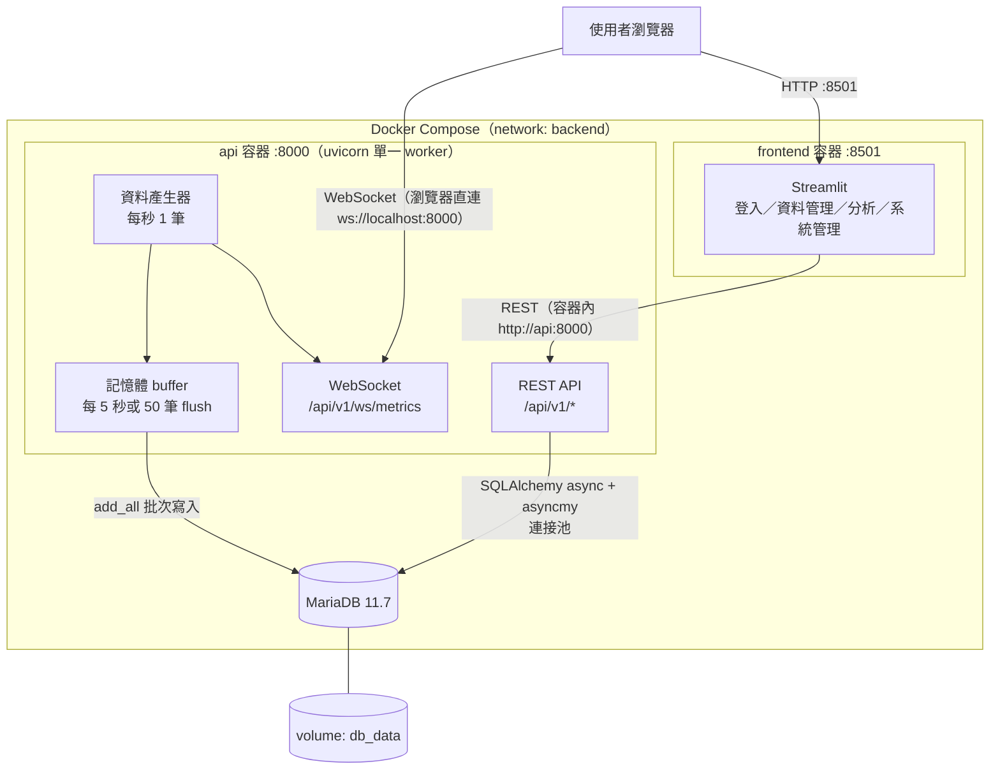
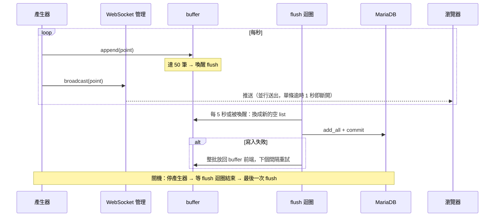

# 即時資料分析與監控系統

FastAPI（REST + WebSocket）＋ MariaDB ＋ Streamlit 的即時資料分析與監控系統。後端每秒產生一筆模擬感測資料，透過 WebSocket 即時推送到前端並批次寫入資料庫；另提供手動資料的 CRUD 與批量匯入、統計分析與 Excel 匯出、三種角色的權限控管與系統管理。

## 一行啟動

```bash
docker compose up --build
```

不需要先建立 `.env`：所有設定在 `docker-compose.yml` 都有開發用預設值（可參考 `.env.example` 覆寫）。首次啟動會自動執行 DB migration 並建立以下測試帳號：

| 角色 | 帳號 | 密碼 | 權限 |
|---|---|---|---|
| Admin | `admin` | `admin12345` | 全部功能，含系統管理；可修改／刪除任何人的資料 |
| User | `user` | `user12345` | 檢視、新增、批量匯入；只能修改／刪除自己建立的資料 |
| Viewer | `viewer` | `viewer12345` | 僅檢視（含即時監控、分析與 Excel 匯出） |

新註冊的帳號預設為 User，由 Admin 在「系統管理」調整角色。

首次啟動時 records（手動資料）是空的，可用 user 帳號在「資料管理 → 批量匯入」上傳 `sample_data/records.csv`；即時資料（metrics）會由後端每秒自動產生。

> 正式環境務必覆寫 `JWT_SECRET_KEY`、資料庫密碼與種子帳號密碼。

## 服務網址

| 服務 | 網址 |
|---|---|
| 前端（Streamlit） | http://localhost:8501 |
| API 文件（Swagger UI） | http://localhost:8000/docs |
| 健康檢查 | http://localhost:8000/health |

在 Swagger 點右上角 **Authorize**，輸入上表任一帳密即可直接測試需登入的 API。

若本機 8501 / 8000 已被佔用，可在 `.env` 設定 `FRONTEND_HOST_PORT`、`API_HOST_PORT`（改了 API port 需同步修改 `PUBLIC_WS_URL`）。

## 功能

| 模組 | 內容 |
|---|---|
| 使用者管理 | 註冊、登入（JWT，OAuth2 password flow）、登出；Admin / User / Viewer 三種角色 |
| 資料管理 | Records CRUD；分頁、篩選（分類、時間範圍、數值範圍）、排序；CSV / JSON 批量匯入（逐列驗證、部分成功、回報錯誤列） |
| 即時監控 | 每秒產生一筆資料、超出閾值標記異常；WebSocket 即時推送；記憶體 buffer 批次寫入 DB；前端即時折線圖＋分類柱狀圖、異常變色與告警 |
| 資料分析 | 總計／平均／最大／最小、分類聚合、依分／時／日的趨勢；可依時間範圍與分類篩選、切換即時資料或手動資料；Excel（.xlsx）匯出 |
| 系統管理（Admin） | 使用者列表、修改角色、停用帳號；系統日誌查詢；資料庫狀態（連線、連接池、各表筆數、待寫 buffer）；即時資料歷史查詢 |

### 主要 API

所有端點都在 `/api/v1` 之下，完整規格見 Swagger。

| 方法 | 路徑 | 說明 | 角色 |
|---|---|---|---|
| POST | `/auth/register`、`/auth/login` | 註冊、登入取得 JWT | 不需登入 |
| GET | `/users/me` | 目前使用者 | 全部 |
| GET / POST | `/records` | 列表（分頁、篩選、排序）／新增 | 讀：全部；寫：Admin、User |
| GET / PUT / PATCH / DELETE | `/records/{id}` | 單筆讀取／整筆取代／部分修改／刪除 | 改刪：建立者或 Admin |
| POST | `/records/import` | CSV / JSON 批量匯入 | Admin、User |
| WS | `/ws/metrics?token=<JWT>` | 即時資料推送 | 全部 |
| GET | `/metrics/latest` | 最新 N 筆即時資料（含尚未寫入 DB 的） | 全部 |
| GET | `/analytics/summary`、`/by-category`、`/trend`、`/export` | 統計、分類聚合、趨勢、Excel 匯出（`source=metrics\|records`） | 全部 |
| GET / PATCH | `/admin/users`、`/admin/users/{id}` | 使用者列表、修改角色／停用 | Admin |
| GET | `/admin/logs`、`/admin/db-status`、`/admin/metrics` | 系統日誌、資料庫狀態、即時資料歷史 | Admin |

錯誤回應統一為 `{"error": {"code", "message", "details"}}`；未登入 401、權限不足 403、驗證錯誤 422。

範例資料：`sample_data/records.csv`（40 筆）、`sample_data/records.json`（10 筆），可在前端「資料管理 → 批量匯入」或 `POST /api/v1/records/import` 上傳。

## 技術棧

| 層 | 技術 |
|---|---|
| 後端 | Python 3.12、FastAPI（async）、Pydantic v2、pydantic-settings、PyJWT、pwdlib（argon2） |
| 資料庫 | MariaDB 11.7、SQLAlchemy 2.1（async ORM）、asyncmy、Alembic |
| 前端 | Streamlit 1.66（`st.navigation` 多頁面）、httpx、Chart.js（即時圖） |
| 匯出 | openpyxl |
| 容器 | 多階段 Dockerfile、Docker Compose、uv（依賴鎖定於 `uv.lock`） |
| 測試 | pytest、pytest-asyncio、httpx，跑在獨立的 MariaDB 測試容器 |

## 架構



> 互動版（可縮放、追蹤連線）：下載 `docs/architecture.html` 以瀏覽器開啟；圖的來源為 `docs/architecture.archify.json`（[archify](https://github.com/tt-a1i/archify) 產生）。以下 Mermaid 版本由 GitHub 直接渲染。



即時資料的路徑（詳細設計見下方「即時資料批次寫入」）：



- Streamlit 的 Python 端在容器網路內以服務名 `api` 呼叫後端；即時監控頁的 JS 跑在瀏覽器，因此直接連主機的 `localhost:8000`。
- 啟動順序：`db` 通過 healthcheck → `api`（`alembic upgrade head` → 建立種子帳號 → uvicorn）通過 `/health` → `frontend`。
- 資料庫只在 compose 內部網路開放，不對主機開 port（本機開發用 `docker-compose.dev.yml`）。

### 專案結構

```
backend/
  app/
    api/v1/        # 路由：auth, users, records, metrics, ws, analytics, admin
    core/          # 設定、JWT／密碼、權限 dependency、錯誤處理、日誌
    db/            # engine／session、Base、UTCDateTime 型別
    models/        # SQLAlchemy models
    schemas/       # Pydantic schemas
    services/      # 業務邏輯（建立者權限、匯入、分析、匯出、系統日誌）
    realtime/      # 資料產生器、buffer、WebSocket 管理
    main.py        # app 與 lifespan（啟動／關閉背景工作）
    seed.py        # 種子帳號
  migrations/      # Alembic
  tests/           # pytest
frontend/
  app.py           # st.navigation：依角色決定頁面
  views/           # 各頁面
  templates/       # 即時監控頁的 HTML／JS
  utils/           # API client、登入狀態、時間轉換、共用元件
sample_data/       # 匯入範例
```

## 本機開發與測試

```bash
# 後端測試（啟動獨立的 MariaDB 測試容器，資料放 tmpfs）
docker compose --profile test run --rm api-test

# 重設資料（刪除 DB volume）
docker compose down -v

# 不經 Docker 跑 API／前端：db 用 dev override 對主機開 3306
docker compose -f docker-compose.yml -f docker-compose.dev.yml up -d db
cd backend && uv sync && uv run alembic upgrade head && uv run python -m app.seed \
  && uv run uvicorn app.main:app --reload
cd frontend && uv sync && uv run streamlit run app.py

# Lint / format
cd backend && uv run ruff check . && uv run ruff format --check .
```

測試涵蓋認證、三種角色權限、Records CRUD／列表／匯入、批次寫入（門檻觸發、失敗放回、上限丟棄、關機 flush）、WebSocket 驗證與廣播、分析與匯出、Admin API。測試使用真實 MariaDB 而非 SQLite：趨勢分析用到的 `CONVERT_TZ` / `DATE_FORMAT` 是 MariaDB 函式。

## 設計決策

### 權限檢查分兩層
- **角色**（admin / user / viewer）由 FastAPI dependency `require_role(...)` 檢查：只需要看登入者本身，在進入業務邏輯前就能擋下。
- **「只有建立者或 Admin 能改」** 放在 service 層：必須先把資料讀出來才知道建立者是誰。

### JWT 只放 user id
角色與啟用狀態每次請求都從 DB 讀取。代價是每個請求多一次主鍵查詢；換來的是 Admin 停用帳號或改角色時立即生效，不必等舊 token 過期。

### 登入失敗不洩漏帳號是否存在
帳號不存在與密碼錯誤回傳相同的 401 與訊息；帳號不存在時也會用一個假 hash 跑一次 argon2 驗證，讓兩種情況的回應時間相近，避免以時間差枚舉帳號。

### 時間一律以 UTC 儲存
MariaDB `DATETIME` 不存時區。`UTCDateTime` 型別在寫入時轉 UTC、讀出時補回 UTC，並拒收沒有時區的 datetime。API 的時間參數使用 Pydantic `AwareDatetime`，沒帶時區或超出 1970–2100 的範圍都回 422（在邊界擋下，避免進到 DB 層溢位變成 500）；匯入時範圍外的列會逐列回報錯誤，不影響其他列。CSV / JSON 匯入例外：沒帶時區的時間視為 Asia/Taipei。

### 批量匯入採部分成功
逐列驗證，合格列以單一 transaction 一次寫入，不合格列回報資料列序號與原因。上限 5 MB / 10,000 列（超過回 413）。

### 即時資料批次寫入
產生器每秒產生一筆資料，同時交給「記憶體 buffer」與「WebSocket 廣播」；buffer 每 5 秒或累積 50 筆（先到者）整批 `add_all` 寫入 DB。
- 每秒寫一次 DB 等於每秒一個 transaction；累積後整批寫入，大幅減少 commit 次數與連線占用。
- 不用共用 `asyncio.Queue`：Queue 每筆只會被一個消費者取走，廣播與寫入會各拿到約一半資料。
- flush 時先把 buffer 換成新的空 list 再寫入：換的動作沒有 `await`，產生器插不進來；寫入期間的新資料進新 list，不會漏也不會重複。
- 寫入失敗（DB 斷線）時資料放回 buffer 前端，下次重試；失敗後等一個完整間隔才重試，避免狂打 DB。buffer 有上限（預設 1 萬筆），超過丟最舊的，避免記憶體無限成長。
- 關機時依序：停產生器 → 等 flush 迴圈跑完當次（用旗標停止，不用 cancel，以免中斷進行中的 commit）→ 最後一次 flush。
- uvicorn 只能 1 個 worker：多 worker 各自跑一個產生器，資料會重複。
- 失敗放回 buffer 屬於 **at-least-once**：若 commit 其實已在 DB 成功、只是回應送回前連線中斷，程式會判定失敗並重送，造成重複資料。正式環境可為每筆資料產生唯一鍵（例如 UUID）並加 unique constraint，以 `INSERT ... ON DUPLICATE KEY` 類的冪等寫入去重。

### WebSocket 推送
- 瀏覽器原生 WebSocket 無法帶 `Authorization` header，JWT 只能放 query string（`?token=`）。代價是 token 會出現在 uvicorn 的 log：WebSocket 握手記在 `uvicorn.error`（不是 access log）。因此在兩個 logger 都加上 filter，把 `token=...` 遮成 `token=***`。
- 驗證失敗時**先 accept 再以 close code 1008 關閉**：若未 accept 就 close，伺服器只會回 HTTP 403，瀏覽器端拿不到 1008 與原因。
- 廣播以 `asyncio.gather` 並行送出，每條連線設 1 秒逾時；逾時或出錯的連線直接移除。若逐一 `await`，一條慢連線會拖住產生器，所有人的資料都延遲。
- `GET /api/v1/metrics/latest` 合併 DB 與 buffer 中尚未寫入（含寫入中）的資料，前端初次載入或 polling 時不會漏掉最近幾秒。

### Streamlit 如何接即時資料
Streamlit 每次互動都會重跑整份 script，Python 端無法長期維持一條 WebSocket 連線。因此即時監控頁用 `st.iframe` 嵌入一段 HTML／JS，由**瀏覽器**直接連 WebSocket 並以 Chart.js 畫圖，是真正的 push 而非 polling。
- **兩個位址**：Streamlit 的 Python 端在容器內呼叫後端用 `API_BASE_URL=http://api:8000`；iframe 的 JS 在使用者瀏覽器執行，用 `PUBLIC_WS_URL=ws://localhost:8000`。
- **初始資料由 Python 端抓好注入**：iframe 內的 JS 若直接 fetch 後端會被 CORS 擋，所以由 Python 端先呼叫 `/api/v1/metrics/latest` 取最近 60 筆，連同 token 以 `json.dumps` 注入（並把 `<`、`>`、`&` 轉成 `\u003c` 等跳脫，資料無法提前結束 script 區塊），不用字串拼接。Chart.js 以 SRI（`integrity`）載入，載入失敗時頁面會顯示提示。
- **頁面不放會觸發重跑的元件**：重跑會重建 iframe，WebSocket 重連、圖表重畫。
- **斷線處理**：收到 close code 1008（token 無效、過期、帳號停用）顯示「請重新登入」且不重連；其他原因（例如 API 重啟）以 1、2、4… 秒漸增間隔自動重連，最長 30 秒。
- **Chart.js 從 CDN（cdnjs）載入**：瀏覽器需能連外網；離線環境需改為把 `chart.umd.min.js` 放進專案由 Streamlit 提供。

### 資料分析
- records 與 metrics 共用 `value / category / timestamp` 三欄，四個分析端點以 `source` 參數切換，聚合邏輯只寫一份。
- 聚合全部用 ORM 表達式：`func.count / sum / avg / max / min` 與 `group_by`。
- **趨勢依台北時間切分**：資料存 UTC，若直接以 UTC 截斷，「一天」會是台北早上 8 點到隔天 8 點。因此先以 `func.convert_tz(timestamp, '+00:00', '+08:00')` 轉換再以 `func.date_format` 截斷到分／時／日（時區由 `ANALYTICS_TIMEZONE` 設定，換算成數字偏移）。用數字偏移 MariaDB 不需匯入時區資料表；台灣無日光節約，不受偏移固定的影響。回傳的 `bucket` 仍統一為 UTC，與其他 API 一致。

### Excel 匯出
- 套用與分析 API 相同的篩選；`data` 工作表上限 5 萬列，超過時保留**最新**的資料（依時間倒序取再反轉），`summary` 工作表記錄篩選條件、實際匯出列數與統計，可看出是否被截斷。
- **防公式注入**：openpyxl 會把 `=` 開頭的字串寫成公式；使用者匯入的 title 若是 `=HYPERLINK(...)`，下載者開檔時就會被執行。所有字串一律強制存成文字。
- Excel 不支援帶時區的時間，因此換成 `ANALYTICS_TIMEZONE`（預設 Asia/Taipei）後去掉時區，欄位標題註明時區。
- 使用 openpyxl 的 write-only 模式逐列寫入，不在記憶體保留整份工作表物件。

### 日誌
- 應用程式日誌以標準 `logging` 輸出到 stdout，用 `docker compose logs api` 查看；等級由 `LOG_LEVEL` 設定。
- 重要操作（登入、登入失敗、註冊、資料新增／修改／刪除／匯入、Admin 修改使用者）另寫入 `system_logs` 表，與業務操作同一個 transaction 提交，可在「系統管理 → 系統日誌」查詢。

### 禁止原生 SQL
應用程式與測試碼內全部使用 SQLAlchemy ORM 表達式，健康檢查也是 `select(literal(1))`。可用下列指令檢查（`send_text(` 這類方法名不會誤判）：

```bash
grep -rnE "(^|[^A-Za-z0-9_])text\(|exec_driver_sql|execute\([\"']" backend/app backend/tests
```

### 容器
- 多階段 Dockerfile：uv 在 builder 階段建好 venv，runtime 只複製 venv 與原始碼，以非 root 使用者執行。
- entrypoint 最後以 `exec` 啟動 uvicorn，讓它成為 PID 1、收得到 `docker stop` 的 SIGTERM，關機流程才會執行。
- 主 `docker-compose.yml` 不對主機開放 DB port，避免審查者本機已有 MySQL 佔用 3306 時啟動失敗；本機開發用 `docker-compose.dev.yml` 開放。

## 已知限制

- **預設 JWT 金鑰是公開的**：為了不建 `.env` 也能一行啟動，`JWT_SECRET_KEY` 有開發用預設值；知道這個值的人可以自行簽出任何使用者（含 Admin）的 token。啟動時若仍使用預設值，log 會印出 WARNING。對外提供服務前必須以環境變數覆寫。
- **服務 port 綁在 0.0.0.0，搭配公開的預設金鑰有區網風險**：compose 的 `8000`、`8501` 對所有網卡開放，同一區網的人可以連進來；若又沒覆寫 `JWT_SECRET_KEY`，對方能自行簽出 Admin token。只在本機試用時可把 port 改成 `127.0.0.1:8000:8000`；對外前務必覆寫金鑰並加反向代理。
- **WebSocket 連線數沒有上限**：任何登入者（含 viewer）都能開多條連線，每多一條都增加每次廣播的成本。正式環境可限制每位使用者的連線數，或在反向代理層限流。
- **分頁與篩選的程式碼有重複**：分頁查詢（count + offset/limit）、`Page[...]` 組裝、時間範圍條件與 `start <= end` 檢查在 records、admin、analytics 各寫了一份。行為正確、各有測試，但可抽成共用的 `paginate()` helper 與時間範圍 mixin。
- **沒有登入頻率限制**：可對 `/auth/login` 無限次嘗試；每次失敗也會寫一筆 `system_logs`。正式環境應依 IP／帳號限流（例如反向代理或 slowapi），並對日誌表設保存期限。
- **廣播最多讓產生器等 1 秒**：產生器會 `await` 本次廣播，慢連線在 `WS_SEND_TIMEOUT_SECONDS`（1 秒）後才被斷開，因此有慢連線時該筆的間隔會拉長到約 2 秒。可改為把廣播丟成背景 task，或以固定節拍（`loop.time()`）排程。
- **前端編輯資料會截掉秒數**：資料管理頁的時間欄位以分鐘為單位，編輯時以 PUT 送出全部欄位，原本帶秒數的時間（例如匯入的 `10:15:30`）會被存成 `10:15:00`。可改為只 PATCH 有變動的欄位。
- **大範圍分析沒有上限**：`trend` 以 `interval=minute` 且不指定日期範圍時，會回傳全部歷史的每分鐘一筆；`summary`／`by-category` 不加篩選時掃描整張 metrics 表；`records` 預設依 `timestamp` 排序但只有 `(category, timestamp)` 複合索引。資料量大時應要求日期範圍、限制區間數，並為 `records.timestamp` 加索引。
- **瀏覽器重新整理會登出**：登入狀態存在 Streamlit 的 `st.session_state`，每個瀏覽器分頁一份，重新整理即清空；要保留需改存 cookie，不在本次範圍。
- **沒有 refresh token**：access token 效期 60 分鐘（`ACCESS_TOKEN_EXPIRE_MINUTES`），過期需重新登入。
- **uvicorn 只能單一 worker**：產生器與 buffer 在行程內，多 worker 會各自產生資料；水平擴展需把產生器獨立成服務、buffer 改用外部佇列。
- **即時資料在記憶體中最多停留一個 flush 間隔**：程序被強制終止（`kill -9`、OOM）時，buffer 中尚未寫入的資料（最多約 5 秒）會遺失；正常 `docker stop` 會執行關機 flush；但若關機時 DB 正好斷線，關機 flush 會卡在連線重試，可能超過 Docker 預設 10 秒寬限期而被 SIGKILL，遺失範圍與強制終止相同。正式環境若不能遺失，應改寫入持久化的訊息佇列（如 Kafka / Redis Streams）再由消費者寫入 DB。
- **列表採 offset 分頁**：頁數很深時 DB 仍需掃過前面所有列（`OFFSET 100000` 很慢）；資料持續新增時，翻頁之間插入的新資料會讓後面的頁出現重複或遺漏。正式環境可改用 keyset（cursor）分頁：以上一頁最後一筆的 `(timestamp, id)` 作為下一頁的起點。
- **即時頁重連期間的資料不會補回**：API 重啟或網路中斷時，重連前的那幾秒在圖上是空白（資料仍有寫入 DB，可從系統管理的歷史查詢看到）。
- **WebSocket 只在握手時驗證 token**：連線建立後，即使 token 過期或帳號被 Admin 停用，仍會持續收到資料，與 REST「停用立即生效」不一致。正式環境可在 token 的 `exp` 到期時由伺服器主動關閉連線，或定期重查 `is_active` 並關閉已停用帳號的連線。
- **匯入的 5 MB 上限只在應用層檢查**：Starlette 在 handler 執行前就已收完整個上傳（大檔暫存到磁碟），`read(上限 + 1)` 只是避免把超出部分讀進 Python 記憶體，無法限制頻寬與磁碟用量。正式環境應在反向代理（例如 Nginx `client_max_body_size`）或依 `Content-Length` 提前拒絕。
